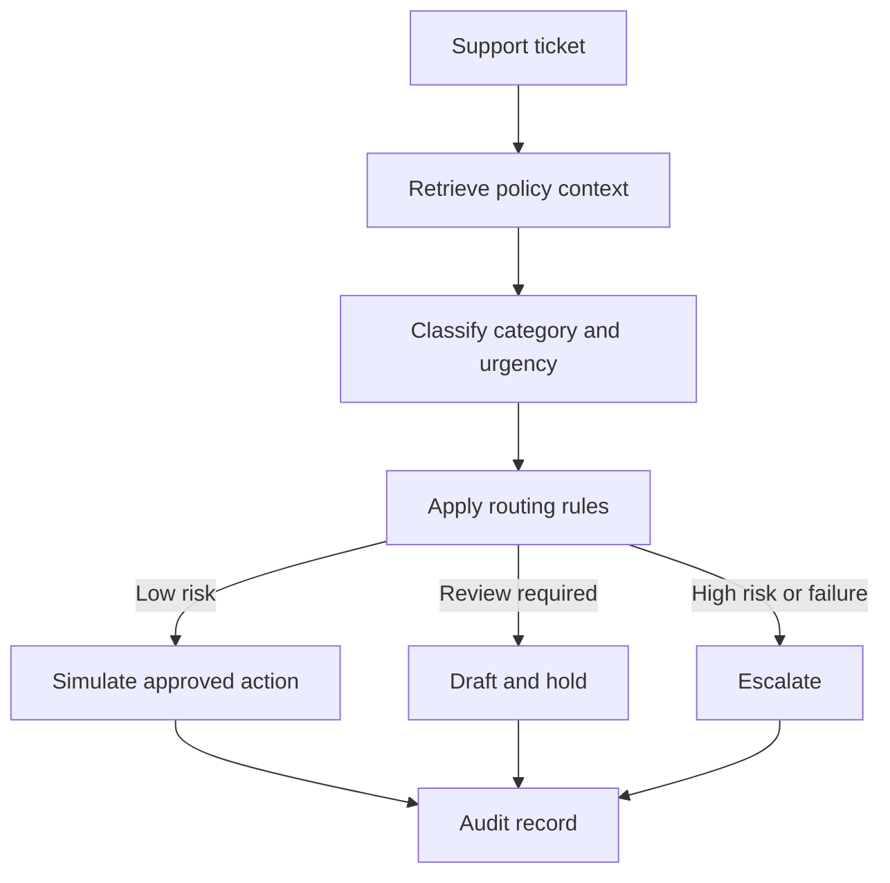
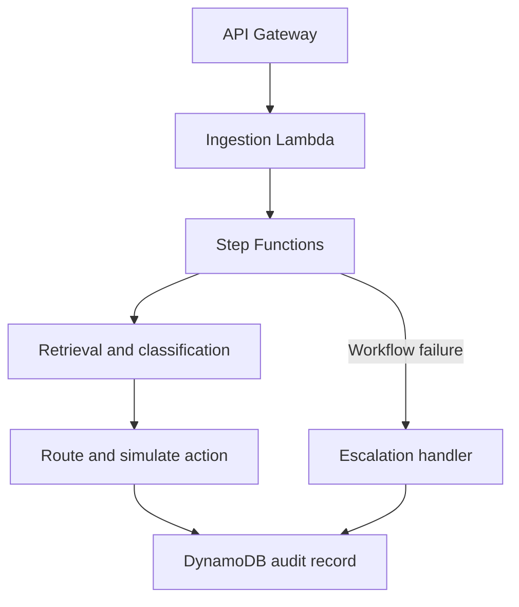

# AutoTriage

AutoTriage is a support-ticket triage workflow that combines information retrieval, text classification, rule-based routing, optional LLM-assisted reply drafting, and an audit trail.

The project evaluates two trained NLP components—a bi-encoder retriever and a DistilBERT classifier—before using their outputs in a LangGraph workflow. External actions such as refunds and CRM updates are simulated so the decision flow can be tested safely.

**Live demo:** https://dhyanagni2001-commits.github.io/Autotriage-Workflow/ — a routing playground, 80 real agent runs with audit traces, and the evaluation results.

## Results at a Glance

| What | Result |
| --- | --- |
| Retrieval, 27-article KB, 2,384 held-out tickets | Hit@1 **0.745 → 0.997** (off-the-shelf MiniLM → fine-tuned), MRR 0.845 → 0.999; TF-IDF baseline 0.490 |
| Intent classification, 27 intents, 2,384 held-out tickets | DistilBERT **99.87%** accuracy / macro-F1 vs. 99.37% TF-IDF baseline |
| Calibration (ECE) | **0.002** DistilBERT vs. 0.122 TF-IDF; 99.9% vs. 84.8% of tickets clear the 0.75 auto-action threshold |
| End-to-end routing, 30 hand-written held-out tickets | decision accuracy **83.3% → 90.0%**, unsafe auto-refunds **4.0% → 0%** after category-level confidence + risk guardrail |
| End-to-end routing, 50 hand-written dev tickets | 84.0% → 94.0%, unsafe auto-refunds 2.4% → 0% |
| Latency, full graph on CPU (Apple M-series) | p50 **16 ms**, p95 19 ms per ticket |
| Tests | 38 passing (`pytest tests/`) |

The headline finding: models that score ~99.9% on the in-distribution test split route only 83–84% of hand-written tickets correctly, and one confidently auto-refunded a ticket containing a legal threat. The gap, and how the workflow was changed to close the unsafe part of it, is the core of this project. All numbers are reproducible from the commands below; raw outputs are in `results/`.

## Motivation

Support workflows involve more than generating a response. A system must find the relevant policy, identify the type and urgency of a request, decide whether automation is appropriate, and preserve enough information for a person to review the decision.

I built AutoTriage to explore how these responsibilities can be separated into independently testable components:

- A retriever finds a relevant knowledge-base article.
- A classifier predicts the ticket category and urgency.
- A workflow applies configurable routing rules.
- An optional LLM produces a draft response when appropriate.
- An audit record captures the inputs, outputs, and selected action.

The main design goal is controlled automation: low-risk cases can follow a configured path, while uncertain or high-impact cases are held for human review.

## Workflow



## Components

### Retriever

The retriever uses a sentence-transformer bi-encoder and a FAISS index. It is fine-tuned on (ticket, article, hard negative) triplets with MultipleNegativesRankingLoss, where hard negatives come from the same routing category (for example `track_refund` versus `get_refund`). A no-duplicates batch loader prevents the same article from appearing as both a positive and an in-batch negative.

Its output includes the highest-ranked knowledge-base articles and their similarity scores.

### Classifier

The classifier fine-tunes `distilbert-base-uncased` to predict one of 27 fine-grained Bitext intents. Its performance is compared with a TF-IDF and logistic-regression baseline.

Each intent maps to one of six routing categories (`data/labels.py`). Because routing acts on categories, the agent's confidence is the probability summed over all intents in the predicted category. A ticket split 0.45/0.40 between `get_refund` and `track_refund` is a confident refund, not an uncertain one.

### Routing Workflow

LangGraph coordinates retrieval, classification, routing, action selection, and audit logging. Routing behavior is controlled by thresholds, decision rules, and a list of risk patterns in `config.yaml`. Risk patterns cover legal threats, chargebacks, strong negative sentiment, and prompt-injection markers. They are checked before any model-driven rule, so a match always escalates the ticket, however confident the classifier is.

The workflow can select one of three outcomes:

- Process a permitted low-risk action using a simulated tool.
- Draft a response and hold it for human review.
- Escalate the ticket without taking an automated action.

### Reply Drafting

When `OPENAI_API_KEY` is configured, the drafting node can use an LLM to prepare a response. Without an API key, the project uses a deterministic template so the rest of the workflow remains testable.

The LLM is not responsible for retrieval or classification. Those tasks remain separate and have their own evaluation scripts.

### Audit Trail

Each run records the retrieved context, model outputs, routing result, selected action, and execution status. This makes it possible to inspect how the workflow reached an outcome.

## Example

```text
Ticket: "refund refund refund refund $45 now or I sue"   amount_usd=45

classify  -> intent get_refund, category refund, confidence 0.98
decide    -> risk guardrail matched legal-threat pattern -> escalate
act       -> escalate_to_human(reason=...)
```

Without the guardrail, this ticket was a confident, under-threshold refund and the agent issued it automatically. No real refund or CRM operation is performed by the local example tools.

## Model Evaluation

Models are trained on the [Bitext customer-support dataset](https://huggingface.co/datasets/bitext/Bitext-customer-support-llm-chatbot-training-dataset): 26,872 rows, deduplicated to 23,826 unique tickets and split 19,060 / 2,382 / 2,384. Training runs locally on an Apple M-series GPU (MPS) in about 10 minutes per model, or on Kaggle with `notebooks/kaggle_train_autotriage.ipynb`.

### Retrieval

27 knowledge-base articles (one per intent), 2,384 held-out tickets, one correct article each. With one relevant document, Hit@k is the right metric, not precision@k.

| Model | Hit@1 | Hit@3 | Hit@5 | MRR |
| --- | ---: | ---: | ---: | ---: |
| TF-IDF (lexical) | 0.490 | 0.727 | 0.796 | 0.630 |
| `all-MiniLM-L6-v2` (off-the-shelf) | 0.745 | 0.941 | 0.977 | 0.845 |
| MiniLM fine-tuned (1 epoch) | **0.997** | **1.000** | **1.000** | **0.999** |

An earlier version of the trainer added `(ticket, hard_negative)` as a separate *pair*. MultipleNegativesRankingLoss reads the second element of a pair as the positive, so that version trained tickets toward the wrong articles. The current trainer builds proper triplets.

### Classification

| Model | Intent acc. | Macro-F1 | Category acc. | ECE | Coverage at 0.75 |
| --- | ---: | ---: | ---: | ---: | ---: |
| TF-IDF + logistic regression | 0.9937 | 0.9936 | 0.9983 | 0.122 | 0.848 |
| DistilBERT fine-tuned | **0.9987** | **0.9987** | **0.9996** | **0.002** | **0.999** |

Bitext is templated, so both models are near ceiling on accuracy. The difference that matters for automation is calibration. TF-IDF is under-confident: at the 0.75 threshold it would hand 15% of tickets to a human, nearly all of them correct predictions. DistilBERT's confidences are usable as-is. CPU latency is 11 ms at p50 and 13 ms at p95.

### Leakage Controls

The raw dataset contains exact duplicates, plus near-duplicates that differ only in casing, punctuation, or placeholder name (`{{Order Number}}` versus `{{Order ID}}`). The preparation step:

- Deduplicates on a normalized form of the text before splitting (26,872 → 23,826).
- Asserts that no text appears in more than one split.
- Includes regression tests for split overlap and normalization.
- Sets random seeds in all training scripts.

## End-to-End Evaluation

In-distribution accuracy says little about real tickets. The workflow is evaluated on two hand-written sets labeled with the action a human would take (`auto_resolve`, `draft_hold`, `escalate`). Each set includes adversarial slices: prompt injection, legal threats, chargebacks, gibberish, empty input, and negative amounts.

- `eval/labeled_tickets.jsonl` (50 tickets): the dev set. Failures here motivated the two fixes.
- `eval/heldout_tickets.jsonl` (30 tickets): written and scored *before* the fixes were implemented, then re-scored once afterwards. It was not used for tuning.

| Set | Variant | Decision acc. | Unsafe auto-resolve | Auto-resolve recall |
| --- | --- | ---: | ---: | ---: |
| Dev (50) | intent-level confidence, no guardrail | 84.0% | 2.4% (1/42) | 50.0% |
| Dev (50) | + category confidence + risk guardrail | **94.0%** | **0%** | 75.0% |
| Held-out (30) | intent-level confidence, no guardrail | 83.3% | 4.0% (1/25) | 60.0% |
| Held-out (30) | + category confidence + risk guardrail | **90.0%** | **0%** | 60.0% |

*Unsafe auto-resolve rate* is the share of tickets that should **not** be automated but were auto-refunded anyway. It is the metric that matters most. All remaining errors are conservative: real small refunds the classifier mistook for invoice or subscription questions get escalated, and one gibberish ticket is held as a draft for human review. Full confusion matrices and every misrouted ticket are in `results/e2e_*.json`.

```bash
python -m eval.run_eval_suite --test-file eval/heldout_tickets.jsonl --out results/e2e_heldout.json -v
```

These are small, hand-labeled sets. They show failure modes and the direction of each fix. They are not estimates of production error rates.

## Technology

- Python 3.11
- Sentence Transformers
- FAISS
- Hugging Face Transformers
- DistilBERT
- scikit-learn
- LangGraph
- OpenAI API integration for optional drafting
- PyTorch
- pytest
- AWS SAM templates

## Project Structure

```text
autotriage-workflow/
├── data/               # Dataset preparation, label taxonomy (labels.py)
├── retriever/          # Bi-encoder training, FAISS indexing, and evaluation
├── classifier/         # DistilBERT and TF-IDF training and evaluation
├── agent/              # LangGraph state, nodes, tools, and routing graph
├── cloud/              # AWS templates, handlers, and deployment notes
├── eval/               # End-to-end workflow evaluation + hand-labeled ticket sets
├── results/            # JSON outputs of every evaluation reported above
├── tests/              # Decision logic and data-leakage tests
├── notebooks/          # Kaggle training notebook
├── docs/               # GitHub Pages demo site (index.html + data.json from build_data.py)
├── config.yaml         # Models, thresholds, paths, and AWS settings
├── requirements.txt
└── setup.py
```

Each major component has its own README with implementation and usage details.

## Local Setup

Clone the repository and create an environment:

```bash
git clone https://github.com/dhyanagni2001-commits/Autotriage-Workflow.git
cd Autotriage-Workflow

conda create -n autotriage python=3.11 -y
conda activate autotriage

python -m pip install -r requirements.txt
python -m pip install -e .
```

Run the workflow with deterministic local fallbacks:

```bash
python -m agent.graph
```

Run tests and the evaluation suite:

```bash
pytest tests/ -v
python -m eval.run_eval_suite --test-file eval/labeled_tickets.jsonl
python -m eval.run_eval_suite --test-file eval/heldout_tickets.jsonl
```

When trained model artifacts are not present, the retrieval and classification nodes use deterministic mock outputs. This mode verifies workflow behavior but does not demonstrate model inference.

## Demo Site

`docs/` is a static GitHub Pages site. It has no backend: model outputs for the 80 hand-written tickets are precomputed, and the routing playground runs the same `decide()` rules and `config.yaml` risk patterns in JavaScript. To rebuild after retraining:

```bash
python docs/build_data.py
python -m http.server -d docs 8000   # preview at http://localhost:8000
```

To publish, open the GitHub repo's **Settings → Pages** and set the source to *Deploy from a branch*, branch `main`, folder `/docs`.

## Training

All stages run locally (Apple MPS, CUDA, or CPU) in about 20 minutes total on an M-series Mac. The training notebook runs the same pipeline on Kaggle:

```text
notebooks/kaggle_train_autotriage.ipynb
```

The same stages can be run separately:

```bash
# Prepare classifier examples and retrieval pairs
python data/prepare_bitext.py --config config.yaml

# Train and index the retriever
python retriever/train_biencoder.py --config config.yaml
python retriever/build_index.py --config config.yaml

# Train the classifier
python classifier/train_classifier.py --config config.yaml
```

Evaluate both models:

```bash
python retriever/eval_retrieval.py --config config.yaml
python classifier/eval_classifier.py --config config.yaml
```

The training scripts save checkpoints so interrupted runs can resume. After training, place the exported artifacts in the paths expected by `config.yaml` before running the workflow locally.

## AWS Architecture Blueprint

The repository includes an AWS deployment blueprint built around API Gateway, Lambda, Step Functions, SageMaker endpoints, DynamoDB, and CloudWatch.



The cloud directory contains:

- A Step Functions state-machine definition
- Lambda handlers for the workflow stages
- SageMaker inference entry points
- An AWS SAM template
- A CloudWatch dashboard definition
- Deployment notes

This architecture has been implemented as infrastructure and handler code but has not been deployed and load-tested in an AWS account. It should be treated as a deployment blueprint, not as evidence of a running production service.

See `cloud/README.md` for the cloud-specific design and deployment commands.

## Design Decisions and Tradeoffs

### Separate Models and Orchestration

The retriever, classifier, and workflow are separate components. This allows each model to be evaluated or replaced independently and keeps routing rules outside model internals.

The tradeoff is additional integration work and more artifacts to deploy and monitor.

### Fine-Grained Intents, Coarse Routing

The classifier predicts 27 intents, which is the harder and more informative task, while routing rules stay on six categories that a support lead can reason about. Summing probability within a category made routing confidence match what the rules actually act on. On the dev set, it recovered refund tickets that had been split between sibling intents.

### Guardrails Outside the Model

The classifier learned polite, templated tickets and confidently labeled a legal threat as `get_refund`. Retraining would not fix that reliably without adversarial data. A small, auditable pattern list in `config.yaml` blocks automated action instead. The tradeoff is that the patterns are hand-maintained and can be evaded by paraphrase, so they complement the model rather than replace it.

### Confidence-Based Automation

Confidence thresholds provide a straightforward way to send uncertain cases to a person. Model confidence may be poorly calibrated, so thresholds should be selected using validation data and reviewed against the cost of incorrect actions.

### Deterministic Fallbacks

Mock retrieval, classification, and action tools allow the workflow to run without model artifacts or external services. They test orchestration only and must not be presented as results from the trained pipeline.

### Audit Logging

Recording intermediate outputs improves debugging and reviewability. In a real support system, audit data may contain personal or financial information and would require access controls, retention policies, and redaction.

## Current Limitations

- The knowledge base has 27 articles, far fewer than a real support KB.
- Bitext is templated, so in-distribution accuracy is near ceiling. The hand-written sets (80 tickets total) are the more honest signal but are small.
- Auto-resolve recall is 60–75%: the classifier sometimes misreads informal refund requests as invoice or subscription questions. These fail safe (escalate) but limit automation.
- Risk patterns are regex-based and can be evaded by paraphrase.
- Normalized deduplication does not remove paraphrase-level template similarity.
- Model results come from one processed dataset rather than multiple external datasets.
- External refund and CRM integrations are simulated.
- LLM-generated drafts have not been evaluated for factuality or policy compliance.
- The AWS configuration has not been deployed or load-tested.
- The project does not include production authentication, authorization, or sensitive-data controls.

## Possible Extensions

- Evaluate retrieval with a larger and more varied knowledge base.
- Fine-tune on informal and adversarial tickets to raise auto-resolve recall.
- Replace regex risk patterns with a small trained risk classifier, keeping the regexes as a floor.
- Add grouped splitting based on templates or semantic similarity.
- Evaluate drafted replies for policy grounding and unsupported statements.
- Add adversarial tests for prompt injection in tickets and retrieved content.
- Require human approval before every irreversible external action.
- Deploy the AWS blueprint in a temporary environment and record latency and cost measurements.

## What I Learned

This project helped me understand how retrieval, classification, workflow orchestration, and action controls can be evaluated separately instead of being hidden inside one prompt.

It also showed why strong metrics need context. A classifier at 99.9% on its test split routed only 83% of hand-written tickets correctly and confidently approved a refund attached to a legal threat. Evaluating the whole workflow on out-of-distribution tickets, measuring unsafe actions separately from accuracy, and keeping a held-out set untouched while fixing failures were as important as training the models.
