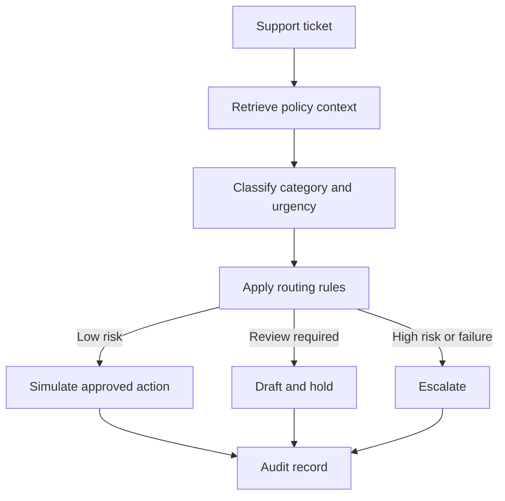
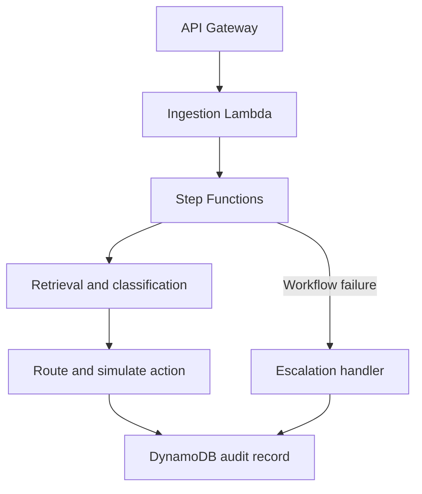

# AutoTriage

AutoTriage is a support-ticket triage workflow that combines information retrieval, text classification, rule-based routing, optional LLM-assisted reply drafting, and an audit trail.

The project evaluates two trained NLP components—a bi-encoder retriever and a DistilBERT classifier—before using their outputs in a LangGraph workflow. External actions such as refunds and CRM updates are simulated so the decision flow can be tested safely.

## Motivation

Support workflows involve more than generating a response. A system must find the relevant policy, identify the type and urgency of a request, decide whether automation is appropriate, and preserve enough information for a person to review the decision.

I built AutoTriage to explore how these responsibilities can be separated into independently testable components:

- A retriever finds a relevant knowledge-base article.
- A classifier predicts the ticket category and urgency.
- A workflow applies configurable routing rules.
- An optional LLM produces a draft response when appropriate.
- An audit record captures the inputs, outputs, and selected action.

The main design goal is controlled automation: low-risk cases can follow a configured path, while uncertain or high-impact cases are held for human review.

## Workflow



## Components

### Retriever

The retriever uses a sentence-transformer bi-encoder and a FAISS index. It is fine-tuned on ticket-to-article pairs using contrastive learning and hard-negative examples.

Its output includes the highest-ranked knowledge-base articles and their similarity scores.

### Classifier

The classifier fine-tunes `distilbert-base-uncased` to predict a coarse support category. Its performance is compared with a TF-IDF and logistic-regression baseline.

The classifier returns structured fields such as category, urgency, and confidence for the routing workflow.

### Routing Workflow

LangGraph coordinates retrieval, classification, routing, action selection, and audit logging. Routing behavior is controlled by thresholds and decision rules in `config.yaml`.

The workflow can select one of three outcomes:

- Process a permitted low-risk action using a simulated tool.
- Draft a response and hold it for human review.
- Escalate the ticket without taking an automated action.

### Reply Drafting

When `OPENAI_API_KEY` is configured, the drafting node can use an LLM to prepare a response. Without an API key, the project uses a deterministic template so the rest of the workflow remains testable.

The LLM is not responsible for retrieval or classification. Those tasks remain separate and have their own evaluation scripts.

### Audit Trail

Each run records the retrieved context, model outputs, routing result, selected action, and execution status. This makes it possible to inspect how the workflow reached an outcome.

## Example

Input ticket:

> I was charged twice for my subscription this month. Can you refund one of the charges? The duplicate charge is $12.99.

Example workflow:

```text
1. Retrieve  -> Find the duplicate-charge refund policy
2. Classify  -> Category: refund; urgency: medium
3. Route     -> Amount is within the configured review threshold
4. Act       -> Call the simulated refund and CRM tools
5. Record    -> Store the decision and action results in the audit trail
```

A larger refund request can be routed to draft-and-hold or escalation instead. The exact behavior is determined by the thresholds in `config.yaml`.

No real refund or CRM operation is performed by the local example tools.

## Model Evaluation

The models were trained using the [Bitext customer-support dataset](https://huggingface.co/datasets/bitext/Bitext-customer-support-llm-chatbot-training-dataset). Exact duplicate ticket text is removed before splitting the examples.

The following results were recorded from the project’s Kaggle training run. They describe this processed dataset and label configuration; they should not be interpreted as expected performance on a live support system.

### Retrieval

The retrieval experiment contains six candidate knowledge-base articles, with one target article for each ticket.

| Model | Top-1 accuracy | MRR |
| --- | ---: | ---: |
| Off-the-shelf `all-MiniLM-L6-v2` | 0.54 | 0.68 |
| Fine-tuned bi-encoder | 0.97 | 0.99 |

The fine-tuned model selected the target article first more frequently in this experiment. Because the candidate collection contains only six articles, this result measures a small retrieval problem rather than large-scale knowledge-base search.

The evaluation code should use terms such as `Hit@k`, `Recall@k`, or top-k accuracy when it measures whether the target appears anywhere in the first `k` results. With one relevant document, that measurement is not precision@k.

### Classification

| Model | Accuracy | Macro-F1 |
| --- | ---: | ---: |
| TF-IDF with logistic regression | 0.992 | 0.992 |
| Fine-tuned DistilBERT | 0.997 | 0.997 |

Both models perform near the ceiling on the six-category mapping. The categories are lexically distinct, so the TF-IDF baseline is already strong and DistilBERT provides only a small improvement.

A more difficult follow-up experiment would retain the dataset’s finer-grained intent labels and evaluate generalization across paraphrases, templates, and unseen issue types.

### Leakage Controls

The raw dataset contains repeated ticket text and unfilled placeholders. A random split performed before deduplication allowed exact copies to appear in both training and evaluation sets, producing overly optimistic results.

The current preparation step:

- Removes exact duplicate ticket text before splitting.
- Checks that identical examples do not appear across splits.
- Includes a regression test for exact-text overlap.
- Sets random seeds in the training scripts.

Exact deduplication does not remove every form of template or semantic similarity. Grouped or template-aware splitting would provide a stronger evaluation of generalization.

## End-to-End Evaluation

Run the workflow evaluation with:

```bash
python -m eval.run_eval_suite --test-file eval/labeled_tickets.jsonl
```

The evaluation suite reports workflow-level measurements such as routing accuracy, auto-process rate, and escalation rate on the labeled examples.

These results evaluate the configured rules and test cases. They do not measure the operational safety of automating actions in a real customer-support environment.

## Technology

- Python 3.11
- Sentence Transformers
- FAISS
- Hugging Face Transformers
- DistilBERT
- scikit-learn
- LangGraph
- OpenAI API integration for optional drafting
- PyTorch
- pytest
- AWS SAM templates

## Project Structure

```text
autotriage-workflow/
├── data/               # Dataset preparation and processed data
├── retriever/          # Bi-encoder training, FAISS indexing, and evaluation
├── classifier/         # DistilBERT and TF-IDF training and evaluation
├── agent/              # LangGraph state, nodes, tools, and routing graph
├── cloud/              # AWS templates, handlers, and deployment notes
├── eval/               # End-to-end workflow evaluation
├── tests/              # Decision logic and data-leakage tests
├── notebooks/          # Kaggle training notebook
├── config.yaml         # Models, thresholds, paths, and AWS settings
├── requirements.txt
└── setup.py
```

Each major component has its own README with implementation and usage details.

## Local Setup

Clone the repository and create an environment:

```bash
git clone https://github.com/dhyanagni2001-commits/Autotriage-Workflow.git
cd Autotriage-Workflow

conda create -n autotriage python=3.11 -y
conda activate autotriage

python -m pip install -r requirements.txt
python -m pip install -e .
```

Run the workflow with deterministic local fallbacks:

```bash
python -m agent.graph
```

Run tests and the evaluation suite:

```bash
pytest tests/ -v
python -m eval.run_eval_suite --test-file eval/labeled_tickets.jsonl
```

When trained model artifacts are not present, the retrieval and classification nodes use deterministic mock outputs. This mode verifies workflow behavior but does not demonstrate model inference.

## Training

The training notebook runs data preparation, retriever fine-tuning, FAISS index creation, classifier fine-tuning, and model evaluation on Kaggle:

```text
notebooks/kaggle_train_autotriage.ipynb
```

The same stages can be run separately:

```bash
# Prepare classifier examples and retrieval pairs
python data/prepare_bitext.py --config config.yaml

# Train and index the retriever
python retriever/train_biencoder.py --config config.yaml
python retriever/build_index.py --config config.yaml

# Train the classifier
python classifier/train_classifier.py --config config.yaml
```

Evaluate both models:

```bash
python retriever/eval_retrieval.py --config config.yaml
python classifier/eval_classifier.py --config config.yaml
```

The training scripts save checkpoints so interrupted runs can resume. After training, place the exported artifacts in the paths expected by `config.yaml` before running the workflow locally.

## AWS Architecture Blueprint

The repository includes an AWS deployment blueprint built around API Gateway, Lambda, Step Functions, SageMaker endpoints, DynamoDB, and CloudWatch.



The cloud directory contains:

- A Step Functions state-machine definition
- Lambda handlers for the workflow stages
- SageMaker inference entry points
- An AWS SAM template
- A CloudWatch dashboard definition
- Deployment notes

This architecture has been implemented as infrastructure and handler code but has not been deployed and load-tested in an AWS account. It should be treated as a deployment blueprint, not as evidence of a running production service.

See `cloud/README.md` for the cloud-specific design and deployment commands.

## Design Decisions and Tradeoffs

### Separate Models and Orchestration

The retriever, classifier, and workflow are separate components. This allows each model to be evaluated or replaced independently and keeps routing rules outside model internals.

The tradeoff is additional integration work and more artifacts to deploy and monitor.

### Small Knowledge Base

The six-article knowledge base makes experiments fast and makes retrieval failures easy to inspect. It does not represent the indexing, latency, and ambiguity challenges of a large support knowledge base.

### Coarse Classification Labels

Six broad categories simplify routing but also make the classification task relatively easy. Higher accuracy on this mapping does not necessarily imply strong performance on fine-grained support intents.

### Confidence-Based Automation

Confidence thresholds provide a straightforward way to send uncertain cases to a person. Model confidence may be poorly calibrated, so thresholds should be selected using validation data and reviewed against the cost of incorrect actions.

### Deterministic Fallbacks

Mock retrieval, classification, and action tools allow the workflow to run without model artifacts or external services. They test orchestration only and must not be presented as results from the trained pipeline.

### Audit Logging

Recording intermediate outputs improves debugging and reviewability. In a real support system, audit data may contain personal or financial information and would require access controls, retention policies, and redaction.

## Current Limitations

- The retriever searches only six canonical articles.
- Classification uses six coarse categories with strong lexical separation.
- Deduplication handles exact matches but not all template-level similarity.
- Model results come from one processed dataset rather than multiple external datasets.
- External refund and CRM integrations are simulated.
- LLM-generated drafts have not been evaluated for factuality or policy compliance.
- The AWS configuration has not been deployed or load-tested.
- The project does not include production authentication, authorization, or sensitive-data controls.

## Possible Extensions

- Evaluate retrieval with a larger and more varied knowledge base.
- Use the original fine-grained intent labels for classification.
- Add grouped splitting based on templates or semantic similarity.
- Calibrate classifier confidence before setting automation thresholds.
- Evaluate drafted replies for policy grounding and unsupported statements.
- Add adversarial tests for prompt injection in tickets and retrieved content.
- Require human approval before every irreversible external action.
- Deploy the AWS blueprint in a temporary environment and record latency and cost measurements.

## What I Learned

This project helped me understand how retrieval, classification, workflow orchestration, and action controls can be evaluated separately instead of being hidden inside one prompt.

It also showed why strong metrics need context: the classifier’s high score is partly explained by coarse, lexically distinct labels, while the retriever’s results come from a small candidate collection. Identifying duplicate leakage and comparing against simple baselines were as important as training the larger models.
